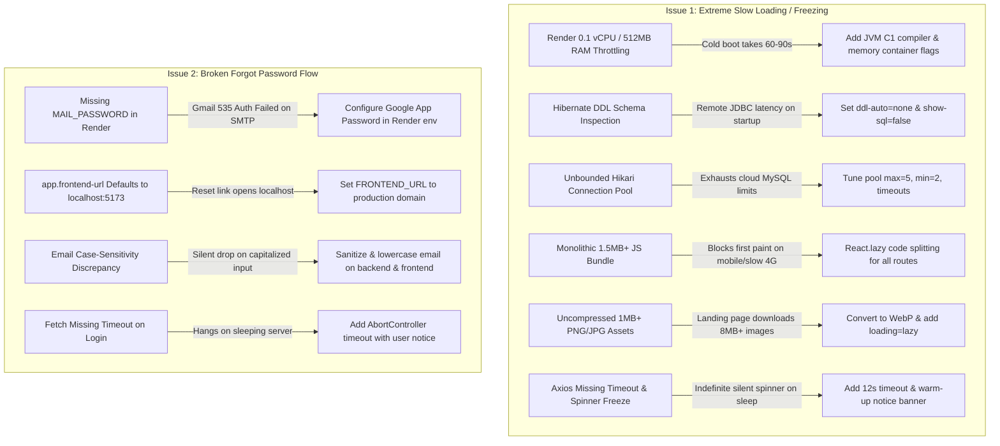

# Implementation Plan: Duyanan 2.0 Performance Optimization & Forgot Password Remediation

## Executive Summary
This document provides a comprehensive, phased execution plan to eliminate production cold starts, freezing, and broken password resets on the Duyanan 2.0 deployment (Spring Boot 4 / Java 17 + React 19 Vite on Render).

---

## 🔍 Root Cause Analysis & Proposed Solutions



---

## 📅 Phased Execution Plan

### Phase 1: Backend & Container Optimization (Render Cold Start & DB Performance)

#### 1.1 Dockerfile JVM Container Tuning ([`backend/Dockerfile`](../backend/Dockerfile))
- **Problem**: Default JVM in Java 17 starts multi-threaded tiered C2 compilers and GC threads that starve Render's 0.1 vCPU, taking 60–90+ seconds to boot.
- **Solution**:
  - Update `ENTRYPOINT` to execute with low-footprint container flags and support `$JAVA_OPTS`:
    ```dockerfile
    ENV JAVA_OPTS="-XX:+TieredCompilation -XX:TieredStopAtLevel=1 -Xss256k -XX:MaxRAMPercentage=75.0 -Djava.security.egd=file:/dev/./urandom"
    ENTRYPOINT ["sh", "-c", "java $JAVA_OPTS -jar app.jar"]
    ```
  - **Impact**: Drops JVM startup time by 40–60% on constrained vCPU instances and prevents Linux OOM (Out Of Memory) container kills.

#### 1.2 Database & Hibernate Configuration ([`application.properties`](../backend/src/main/resources/application.properties))
- **Problem**: `spring.jpa.hibernate.ddl-auto=update` queries all database tables over remote JDBC on every single wake-up. `spring.jpa.show-sql=true` floods container stdout and throttles I/O.
- **Solution**:
  - Make DDL and SQL logging environment-aware:
    ```properties
    spring.jpa.hibernate.ddl-auto=${SPRING_JPA_HIBERNATE_DDL_AUTO:none}
    spring.jpa.show-sql=${SHOW_SQL:false}
    ```
  - Configure HikariCP connection pool properties:
    ```properties
    spring.datasource.hikari.maximum-pool-size=${DB_MAX_POOL_SIZE:5}
    spring.datasource.hikari.minimum-idle=${DB_MIN_IDLE:2}
    spring.datasource.hikari.idle-timeout=600000
    spring.datasource.hikari.max-lifetime=1800000
    spring.datasource.hikari.connection-timeout=10000
    spring.datasource.hikari.keepalive-time=30000
    ```

#### 1.3 Hikari Pool Tuning in Code ([`DataSourceConfig.java`](../backend/src/main/java/com/duyanan/backend/config/DataSourceConfig.java))
- **Problem**: `DataSourceConfig` creates a manual `new HikariConfig()` instance, bypassing Spring Boot auto-configuration if properties are not explicitly assigned.
- **Solution**:
  - Explicitly set maximum pool size to 5, minimum idle to 2, keepalive time to 30,000ms, and connection timeout to 10,000ms on the `HikariConfig` object.

#### 1.4 Static Upload Caching ([`WebConfig.java`](../backend/src/main/java/com/duyanan/backend/config/WebConfig.java))
- **Problem**: `/uploads/**` lacks `CacheControl` headers, forcing repeated full image downloads.
- **Solution**:
  - Add `.setCacheControl(CacheControl.maxAge(7, TimeUnit.DAYS).cachePublic())` to resource handlers.

#### 1.5 Ping / Health Check Endpoint ([`HealthController.java`](../backend/src/main/java/com/duyanan/backend/controller/HealthController.java) & [`SecurityConfig.java`](../backend/src/main/java/com/duyanan/backend/config/SecurityConfig.java))
- **Problem**: Render free instances spin down after 15 minutes of inactivity. There is no lightweight endpoint for uptime monitors to ping without invoking database overhead or JWT checks.
- **Solution**:
  - Create a new `HealthController` with `GET /api/health` returning `{"status": "UP", "timestamp": ...}`.
  - Add `/api/health` to `.permitAll()` in `SecurityConfig.java`.
  - Enables zero-cost keep-alive pings (via cron-job.org or UptimeRobot) every 10–14 minutes.

---

### Phase 2: Forgot Password Flow Remediation

#### 2.1 Backend Email Sanitization ([`UserController.java`](../backend/src/main/java/com/duyanan/backend/controller/UserController.java))
- **Problem**: `forgotPassword` takes raw `body.get("email")` without trimming or lowercasing. Since registration stores normalized lowercase emails, any uppercase characters or accidental spaces cause lookup failure. Additionally, mail sending exceptions were not logging the root error.
- **Solution**:
  - Sanitize email: `String email = rawEmail.trim().toLowerCase();`.
  - Validate email format with regex before querying.
  - Log error details (`log.error("Failed to send reset email to {}", email, e);`) so administrators can immediately diagnose SMTP authorization issues from Render logs.

#### 2.2 Frontend Sanitization & UX ([`Login.jsx`](../frontend/src/pages/Login.jsx))
- **Problem**: SweetAlert email prompt passes raw input. If the backend is sleeping, the request hangs indefinitely.
- **Solution**:
  - Sanitize input: `cleanEmail = email.trim().toLowerCase()`.
  - Add a 15-second timeout with `AbortController`.
  - If the request takes longer than 3 seconds, show an informative status note: *"Waking up server, please allow a few seconds..."*.

#### 2.3 Render Environment Configuration Requirements
- Define exact values to configure in Render Dashboard:
  - `MAIL_USERNAME=duyanankainan@gmail.com`
  - `MAIL_PASSWORD=<16-character Google App Password>` (NOT the account login password)
  - `FRONTEND_URL=https://duyanan-restaurant.onrender.com` (matching production URL)

---

### Phase 3: Frontend Performance & Bundle Splitting

#### 3.1 Route Code-Splitting with `React.lazy()` ([`App.jsx`](../frontend/src/App.jsx))
- **Problem**: `App.jsx` statically bundles `AdminPanel.jsx` (181.5 KB, 2,355 lines), `Menu.jsx` (96 KB), `Profile.jsx` (92.5 KB), and all other subpages into the primary landing bundle.
- **Solution**:
  - Dynamically load pages:
    ```jsx
    const Home = React.lazy(() => import('./pages/Home'));
    const Menu = React.lazy(() => import('./pages/Menu'));
    const AdminPanel = React.lazy(() => import('./pages/AdminPanel'));
    const EventPackages = React.lazy(() => import('./pages/EventPackages'));
    const GroupMeals = React.lazy(() => import('./pages/GroupMeals'));
    const Reservations = React.lazy(() => import('./pages/Reservations'));
    const About = React.lazy(() => import('./pages/About'));
    const Login = React.lazy(() => import('./pages/Login'));
    const Register = React.lazy(() => import('./pages/Register'));
    const Profile = React.lazy(() => import('./pages/Profile'));
    const ResetPassword = React.lazy(() => import('./pages/ResetPassword'));
    const CartPage = React.lazy(() => import('./pages/CartPage'));
    ```
  - Wrap routes in `<Suspense fallback={<PageLoadingFallback />}>` with a branded Duyanan loader.

#### 3.2 Axios Timeout & Warm-up UX ([`Menu.jsx`](../frontend/src/pages/Menu.jsx))
- **Problem**: Unbounded `axios.get()` hangs indefinitely when the backend container is spinning up.
- **Solution**:
  - Add `{ timeout: 15000 }` to `axios.get()`.
  - Add a server warm-up timer: after 3 seconds of loading, display a warm-up banner:
    *"☕ Duyanan's cloud kitchen is waking up from idle... Please hold on a few seconds while we fire up the ovens!"*
  - Include an interactive "Retry" button if timeout occurs, alongside fallback dishes.

#### 3.3 Asset Optimization (WebP Conversion & `loading="lazy"`)
- **Problem**: `duyanan_bg.jpg` (600 KB), `turon.png` (737 KB), `sfc.png` (585 KB), and event images (1.1 MB each) total over 8 MB of uncompressed bandwidth.
- **Solution**:
  - Convert PNG/JPEG hero and event images to modern WebP format using lossless/high-quality compression (target 80–85% size reduction).
  - Add `loading="lazy"` to below-the-fold images in `Home.jsx`, `About.jsx`, and `Menu.jsx`.

---

### Phase 4: Verification, Testing & Deployment Checklist

#### 4.1 Verification Matrix
| Test Case | Target | Expected Result |
| :--- | :--- | :--- |
| **JVM Flags** | `Dockerfile` | Container boots with C1 compiler, stops at Tier 1, stack size 256k |
| **Health Check** | `GET /api/health` | Returns `200 OK` with JSON status without authentication |
| **HikariCP** | `DataSourceConfig` | Max 5 connections, 10s connection timeout |
| **Cache Headers** | `GET /uploads/*` | Response header includes `Cache-Control: max-age=604800, public` |
| **Forgot Password** | `POST /api/auth/forgot-password` | Handles `User@Email.COM ` identically to `user@email.com` |
| **Email Reset Link** | `EmailService` | Contains production `FRONTEND_URL` instead of `localhost:5173` |
| **Bundle Split** | `npm run build` | `AdminPanel` and pages build into separate chunk files; initial JS drops from ~1.2MB to ~250KB |
| **Warm-up UX** | `Menu.jsx` | Clear warm-up alert displays after 3s if server is sleeping; no infinite spinner |

#### 4.2 Production Render Deployment Checklist
1. Add Environment Variables in Render Backend:
   - `SPRING_JPA_HIBERNATE_DDL_AUTO=none`
   - `SHOW_SQL=false`
   - `FRONTEND_URL=https://<your-render-frontend-domain>`
   - `MAIL_USERNAME=duyanankainan@gmail.com`
   - `MAIL_PASSWORD=<google-app-password>`
2. Set up Free Uptime Ping:
   - Configure cron-job.org or UptimeRobot to ping `https://<backend-url>/api/health` every 10 minutes.
